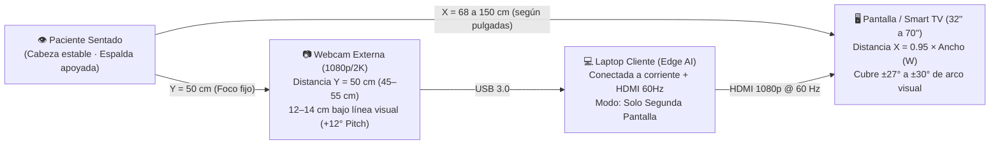

# Parametrización Clínica, Óptica y Especificaciones de Hardware — NeuroVisión Rehab

> **Propósito del documento:** Guía técnica y metodológica de referencia para el capítulo de **Diseño Experimental, Parametrización del Entorno Clínico y Requerimientos No Funcionales** de la tesis. Todos los rangos físicos, trigonométricos y computacionales aquí documentados son **100% consistentes con las constantes matemáticas y umbrales programados en el código fuente** de la plataforma.

---

## 1. Fundamentación de la Arquitectura Espacial Desacoplada ($X \neq Y$)

En los sistemas convencionales de *eye-tracking* basados en cámara web integrada (p. ej., uso exclusivo de una laptop de $14\text{''}\text{–}15.6\text{''}$ a $50\text{ cm}$), existe un **compromiso físico-óptico** difícil de resolver cuando la pantalla y la cámara comparten el mismo plano ($X = Y$):

1. **Si se usa una pantalla pequeña cerca ($X = Y = 50\text{ cm}$ en $15.6\text{''}$):** La cámara obtiene buena resolución del iris, pero la pantalla apenas cubre $\pm 19.0^\circ$ horizontales y $\pm 10.9^\circ$ verticales, limitando la amplitud de las sacadas compensatorias requeridas en rehabilitación de hemianopsia o cuadrantanopsia.
2. **Si se usa una TV grande lejos con la cámara montada sobre la TV ($X = Y \ge 150\text{ cm}$):** Se gana amplitud visual, pero el diámetro aparente del iris humano ($\approx 11.8\text{ mm}$) cae por debajo de $12\text{ píxeles}$ en un sensor 1080p estándar ($\text{FOV} \approx 68^\circ$), degradando severamente la precisión sub-píxel de *MediaPipe FaceLandmarker* e invalidando el seguimiento.

### Solución Metodológica Adoptada: Desacoplamiento Pantalla–Sensor ($X > Y$)

Separar el **plano de estimulación visual** (TV/monitor de gran formato a distancia $X$) del **plano de captura biométrica** (webcam externa en campo cercano a distancia fija $Y$) permite optimizar simultáneamente ambas variables:

### Beneficios directos para la precisión del algoritmo:
1. **Máxima densidad de píxeles en el iris ($Y = 50\text{ cm}$):** El iris ocupa entre **35 y 45 píxeles** de diámetro, reduciendo el ruido cuántico en el centroide de 5 puntos (`landmarks 468–472` y `473–477`).
2. **Mayor relación Señal-a-Ruido (SNR) en la regresión polinomial:** Al obligar al ojo a barrer un ángulo real amplio ($\pm 27^\circ\text{ a }\pm 30^\circ$) sobre la TV de fondo, el desplazamiento físico del iris dentro de la hendidura palpebral es casi el doble que frente a una laptop chica, mejorando la fidelidad ($R^2$) de la calibración de 9 puntos (`zhangYinModel.ts`).
3. **Relajación acomodativa ocular (menor fatiga visual):** A distancias $X \ge 90\text{–}150\text{ cm}$, el esfuerzo acomodativo del cristalino cae de $2.0\text{ dioptrías}$ (a $50\text{ cm}$) a solo **$0.66\text{–}1.1\text{ dioptrías}$**, evitando astenopía y cefalea durante sesiones de rehabilitación de 15 a 20 minutos.

---

## 2. Parametrización de la Pantalla y Distancia Óptima ($X$) — De 24" a 70"

### 2.1 Modelo Trigonométrico Retinotópico
En neuro-oftalmología clínica, el **rango oculomotor fisiológico sin rotación compensatoria de cuello** abarca hasta **$\pm 25^\circ\text{–}30^\circ$** desde la fóvea central (equivalente a **$50^\circ\text{–}60^\circ$ de campo horizontal total**). En concordancia con ello, el motor geométrico del sistema (`src/infrastructure/therapy/retinotopicGeometry.ts`) define:
- `MIN_ECCENTRICITY_DEG = 5°`
- `MAX_ECCENTRICITY_DEG = 30°`

Para un panel de relación de aspecto `16:9` con ancho activo $W$ y alto activo $H$, el ángulo visual semi-horizontal ($\theta_H$, excentricidad izquierda/derecha) y semi-vertical ($\theta_V$) a una distancia perpendicular ojo–pantalla $X$ están dados por:

$$\theta_H = \arctan\left(\frac{W / 2}{X}\right), \qquad \theta_V = \arctan\left(\frac{H / 2}{X}\right)$$

Despejando $X$ para cubrir el rango terapéutico óptimo ($\theta_H \in [25^\circ, 30^\circ]$, con punto dulce en **$\theta_H \approx 27.8^\circ \implies 55.6^\circ$ de arco total**):

$$X_{\text{mín (30°)}} = \frac{W / 2}{\tan(30^\circ)} \approx 0.866 \cdot W, \qquad X_{\text{ideal (27.8°)}} \approx 0.95 \cdot W, \qquad X_{\text{máx (25°)}} = \frac{W / 2}{\tan(25^\circ)} \approx 1.072 \cdot W$$

### 2.2 Tabla Maestra de Distancias $X$ por Tamaño de Pantalla (24" hasta 70")

| Diagonal (16:9) | Dimensiones Activas ($W \times H$) | Rango Clínico Óptimo $X$ ($\pm 30^\circ\text{ a }\pm 25^\circ$) | Distancia Ideal $X$ ($\approx \pm 27.8^\circ$) | Campo Horizontal Cubierto ($\pm \theta_H$ / Total) | Campo Vertical Cubierto ($\pm \theta_V$ / Total) | Demanda Acomodativa ($100/X$) | Escenario de Uso Recomendado |
| :---: | :---: | :---: | :---: | :---: | :---: | :---: | :--- |
| **24"** | $53.1 \times 29.9\text{ cm}$ | $46\text{ – }57\text{ cm}$ | **50 cm** | $\pm 28.0^\circ$ ($56.0^\circ$) | $\pm 16.6^\circ$ ($33.2^\circ$) | $2.00\text{ D}$ | Escritorio compacto ($X = Y$) |
| **27"** | $59.8 \times 33.6\text{ cm}$ | $52\text{ – }64\text{ cm}$ | **56 cm** | $\pm 28.1^\circ$ ($56.2^\circ$) | $\pm 16.7^\circ$ ($33.4^\circ$) | $1.79\text{ D}$ | Escritorio estándar ($X \approx Y$) |
| **32"** | $70.8 \times 39.8\text{ cm}$ | $61\text{ – }76\text{ cm}$ | **68 cm** | $\pm 27.5^\circ$ ($55.0^\circ$) | $\pm 16.3^\circ$ ($32.6^\circ$) | $1.47\text{ D}$ | Escritorio profundo / Box pequeño |
| **40"** | $88.6 \times 49.8\text{ cm}$ | $77\text{ – }95\text{ cm}$ | **84 cm** | $\pm 27.8^\circ$ ($55.6^\circ$) | $\pm 16.5^\circ$ ($33.0^\circ$) | $1.19\text{ D}$ | Consultorio / Habitación |
| **43"** ⭐ | $95.2 \times 53.5\text{ cm}$ | $82\text{ – }102\text{ cm}$ | **90 cm** | $\pm 27.9^\circ$ ($55.8^\circ$) | $\pm 16.6^\circ$ ($33.2^\circ$) | $1.11\text{ D}$ | **Estándar clínico ambulatorio** |
| **50"** ⭐ | $110.7 \times 62.3\text{ cm}$ | $96\text{ – }119\text{ cm}$ | **105 cm** | $\pm 27.8^\circ$ ($55.6^\circ$) | $\pm 16.5^\circ$ ($33.0^\circ$) | $0.95\text{ D}$ | **Consultorio amplio / Sala** |
| **55"** | $121.8 \times 68.5\text{ cm}$ | $105\text{ – }131\text{ cm}$ | **115 cm** | $\pm 27.9^\circ$ ($55.8^\circ$) | $\pm 16.6^\circ$ ($33.2^\circ$) | $0.87\text{ D}$ | Sala domiciliaria mediana |
| **60"** | $132.8 \times 74.7\text{ cm}$ | $115\text{ – }142\text{ cm}$ | **126 cm** | $\pm 27.8^\circ$ ($55.6^\circ$) | $\pm 16.5^\circ$ ($33.0^\circ$) | $0.79\text{ D}$ | Sala domiciliaria amplia |
| **65"** | $143.9 \times 81.0\text{ cm}$ | $125\text{ – }154\text{ cm}$ | **136 cm** | $\pm 27.9^\circ$ ($55.8^\circ$) | $\pm 16.6^\circ$ ($33.2^\circ$) | $0.74\text{ D}$ | Sala grande / Gabinete clínico |
| **70"** 🎯 | **$155.0 \times 87.2\text{ cm}$** | **$134\text{ – }166\text{ cm}$** *(tolerable hasta $180\text{ cm}$)* | **147 cm** *(~1.45 – 1.50 m)* | **$\pm 27.8^\circ$ ($55.6^\circ$)** | **$\pm 16.5^\circ$ ($33.0^\circ$)** | **$0.68\text{ D}$** | **Entorno de pruebas de gran formato (70")** |

### 2.3 Notas específicas para el entorno de validación en TV de 70"
- **Distancia óptima ($X$):** Situar la silla del paciente de modo que sus ojos queden a **1.45 m – 1.50 m** de la pantalla de 70" (con un margen funcional muy cómodo de **1.35 m a 1.80 m**; incluso a $1.80\text{ m}$ aún se conserva $\pm 23.3^\circ = 46.6^\circ$ horizontales).
- **Qué evitar en 70":**
  - *No sentarse a menos de $1.20\text{ m}$:* El ángulo supera $\pm 33^\circ$, induciendo giro involuntario de cuello y fatiga periférica.
  - *No sentarse a distancia de sofá lejano ($2.8\text{ m – }3.5\text{ m}$):* A $3.0\text{ m}$, hasta una TV de 70" se reduce ópticamente a solo $\pm 14.5^\circ$, perdiendo la ventaja del gran formato.
- **Confort visual superior:** A $1.50\text{ m}$, la demanda acomodativa es de apenas **$0.68\text{ dioptrías}$** (prácticamente visión lejana descansada) y el trípode de la webcam a $Y = 50\text{ cm}$ queda completamente por debajo del cono visual hacia la TV.

---

## 3. Parametrización del Sensor Biométrico / Webcam ($Y$)

Independientemente de si la TV del fondo es de 43", 50" o 70", **la distancia entre el rostro del paciente y la webcam ($Y$) se mantiene constante**:

| Parámetro de la Webcam | Valor Óptimo | Rango Aceptado | Sustento en el Código y Algoritmo |
| :--- | :---: | :---: | :--- |
| **Distancia Rostro–Webcam ($Y$)** | **50 cm** | **45 – 55 cm** *(software: 40–60 cm)* | `useEnvironmentalValidation.ts` estima $Z$ por distancia interpupilar (`rawDist = 5.75 / ipd`, asumiendo $\text{IPD}_{\text{adulto}} \approx 6.3\text{ cm}$) y aprueba entre **38 cm y 63 cm**. A **50 cm** se maximiza el diámetro del iris en píxeles sin riesgo de salirse del encuadre ante leves posturas. |
| **Posición Horizontal (Yaw)** | **$0\text{ cm}$ (Eje central)** | $\pm 2\text{ cm}$ | Alineada exactamente con la línea media vertical de la TV y el plano sagital del paciente para garantizar simetría entre el hemicampo izquierdo y derecho. |
| **Posición Vertical y Ángulo (*Pitch*)** | **12 a 15 cm bajo la altura de los ojos**, inclinada **$+12^\circ\text{ a }+15^\circ$** hacia arriba | Debajo del borde visual inferior de la TV | 1. Evita que el cuerpo de la cámara tape los estímulos inferiores de la TV. 2. **Ventaja anatómica:** Al capturar ligeramente desde abajo, el párpado superior y las pestañas no ocluyen el iris cuando el paciente mira la mitad inferior de la TV, reduciendo el error vertical ($Y$). El ángulo base ($\beta_0$) es neutralizado matemáticamente en el punto central de calibración. |
| **Resolución y Tasa de Cuadros** | **1080p o 1440p (2K) @ 30–60 FPS** | Mínimo `1920×1080` @ 30 FPS | `useWebcam.ts` negocia hasta `2560×1440` y `useMediaPipeWorker.ts` normaliza cada frame a `1280×720` mediante `createImageBitmap` antes de enviarlo al Worker WASM. |
| **Óptica (FOV y Enfoque)** | **FOV $60^\circ\text{ – }75^\circ$** · Enfoque fijo | Evitar gran angular $> 85^\circ$ | Lentes gran angular ($90^\circ+$) empequeñecen el ojo en la imagen e introducen distorsión radial. Si la cámara tiene *autofocus*, se recomienda fijarlo para evitar pulsaciones de re-enfoque (*focus hunting*). |

---

## 4. Condiciones Ambientales, Posturales y de Visualización

1. **Iluminación Fotométrica Ambiental (`350 – 450 Lux`):**
   - El módulo fotométrico (`useEnvironmentalValidation.ts`, luminancia ITU-R BT.601) exige un rango operativo entre **`180 Lux` y `650 Lux`**.
   - **Disposición de la luz:** Luz blanca/neutra difusa frontal o cenital-frontal. **Prohibido el contraluz** (ventanas abiertas o focos detrás del paciente apuntando a la lente de la webcam) y evitar reflejos directos sobre la TV o sobre los cristales en pacientes usuarios de gafas (preferir lentes con tratamiento antirreflejante AR).
2. **Altura Ergonómica de la TV:**
   - El centro geométrico de la TV debe ubicarse a la **altura de los ojos del paciente sentado** ($\approx 110\text{–}120\text{ cm}$ desde el piso) o hasta $3^\circ\text{–}5^\circ$ por debajo, preservando postura cervical neutra.
3. **Estabilidad Postural:**
   - Silla estática (sin ruedas ni giro) con espalda apoyada en el respaldo. Aunque el motor incorpora compensación traslacional por glabela (`landmark 168`) y re-escalado dinámico en eje $Z$ por diámetro de iris (`gazeEnhancements.ts`), mantener la cabeza quieta es indispensable desde el punto de vista **clínico** para asegurar que el paciente entrene sacadas oculares reales y no giros compensatorios de cabeza.
4. **Configuración de Pantalla en el Sistema Operativo:**
   - Configurar la salida HDMI en modo **"Mostrar únicamente en 2" (Solo pantalla externa / TV)** a resolución nativa `1920×1080 @ 60 Hz`, escala `100%` y navegador en **Pantalla Completa (`F11`)**. Apagar el panel interno de la laptop elimina distracciones luminosas laterales y libera recursos de GPU para el Worker de IA.

---

## 5. Especificaciones Técnicas de la Laptop (Mínimas y Recomendadas)

### 5.1 Perfil de Carga Computacional Client-Side (*Edge AI*)
A diferencia de plataformas que transmiten video a servidores GPU en la nube, **NeuroVisión Rehab** procesa todo localmente por **Privacidad desde el Diseño** (`image.close()` destruye cada `ImageBitmap` en RAM apenas termina la inferencia):
- **Hilo 1 (Principal - UI y Motor Gráfico):** Renderizado HTML5 Canvas 2D full-viewport a **60 FPS**, síntesis de Audio Espacial 3D (*Web Audio API*), muestreo ambiental a `10 Hz` y empaquetado de telemetría a `30 Hz`.
- **Hilo 2 (Web Worker Dedicado - `mediapipe.worker.ts`):** Ejecución del modelo `FaceLandmarker (float16)` sobre **WebAssembly SIMD** + **WebGL 2.0 (`delegate: "GPU"`)**.
- **Restricción temporal dura (`gazeFreshnessGuard.ts` y `captureCompatibility.ts`):** La frecuencia de inferencia facial debe ser estrictamente **$\ge 4\text{ Hz}$** ($\le 250\text{ ms}$ por frame; `MAX_GAZE_STALENESS_MS = 280 ms`). Para cuantificar con precisión clínica la latencia sacádica (`ms`), ganancia sacádica, BCEA y DTW, se recomienda operar entre **15 Hz y 30 Hz**.

### 5.2 Matriz de Requerimientos de Hardware (Laptop Cliente)

| Componente | Especificación Mínima *(Operación Básica Validada: 8 – 15 Hz)* | Especificación Recomendada *(Desempeño Clínico Óptimo: 22 – 30+ Hz)* | Justificación Arquitectónica |
| :--- | :--- | :--- | :--- |
| **Procesador (CPU)** | **Intel Core i3 (8va Gen+)** o **AMD Ryzen 3 (Serie 3000+)** • Mínimo **4 núcleos físicos** (4–8 hilos) • Soporte SIMD (**AVX2 / SSE4.2**) | **Intel Core i5 (11va Gen+)**, **AMD Ryzen 5 (Serie 5000+)** o **Apple M1/M2/M3** • **6 a 8 núcleos** (12+ hilos) | Permite ejecutar en paralelo sin contención el hilo de Canvas (60 FPS), el Web Worker WASM de MediaPipe, la decodificación USB de video y el compositor del navegador. |
| **Unidad Gráfica (GPU)** | **GPU integrada compatible con WebGL 2.0 y FP16:** • Intel UHD Graphics 620 • AMD Radeon Vega 3 / 6 | **Intel Iris Xe Graphics**, **AMD Radeon Vega 7/8 / RDNA2**, **Apple GPU** o GPU dedicada de entrada (MX350 / GTX 1650) | El Worker delega los tensores `float16` de `FaceLandmarker` a shaders WebGL 2.0 (`delegate: "GPU"`). Sin aceleración GPU válida, la inferencia cae a CPU y triplica la latencia. |
| **Memoria RAM** | **8 GB DDR4** | **16 GB DDR4 / LPDDR5 en Dual-Channel** | Windows + navegador + heap WASM/WebGL rondan ~5.0–5.5 GB en sesión activa. En GPUs integradas (UHD / Iris Xe / Vega), la memoria en **Dual-Channel** duplica el ancho de banda gráfico. |
| **Salida de Video** | **HDMI 1.4b** (`1920×1080 @ 60 Hz`) | **HDMI 2.0+** o **USB-C DisplayPort Alt-Mode** | Garantiza refresco estable a `60 Hz` en la TV externa (hasta 70" en 1080p) sincronizado con `requestAnimationFrame`. |
| **Interfaz de Cámara** | **1× Puerto USB 3.0 (USB 3.2 Gen 1 - 5 Gbps)** | **USB 3.0 / USB-C directo al chipset** (sin hubs USB 2.0) | Evita cuellos de botella de ancho de banda y artefactos de compresión MJPEG sobre los bordes pupilares en flujos 1080p/2K. |
| **Almacenamiento** | **SSD SATA / NVMe** con `2 GB` libres | **SSD NVMe M.2** | Carga ágil del sistema operativo, caché del navegador y binarios WASM (~15 MB). |
| **Sistema Operativo y Navegador** | • Windows 10 64-bit (21H2+) / macOS 12+ • **Chrome 116+** o **Edge 116+** con *Aceleración por hardware* activa | • Windows 11 64-bit en plan de energía **"Alto rendimiento / Conectada a corriente"** • Chrome / Edge actualizado | Garantiza soporte de `OffscreenCanvas`, `ImageBitmap` redimensionado y evita el *throttling* de CPU/GPU por batería baja. |
| **Red e Internet** | **5 Mbps bajada / 1 Mbps subida** (Latencia `< 150 ms`) | **15+ Mbps** Wi-Fi 5/6 o Ethernet (Latencia `< 80 ms`) | No se transmite video ni imágenes; únicamente lotes JSON de telemetría (~15–25 KB cada 2 s $\approx 100\text{ Kbps}$) y eventos clínicos idempotentes. |

### 5.3 Exclusiones Técnicas (Equipos No Soportados para Modo Webcam)
Para delimitar formalmente el alcance experimental en la tesis, quedan excluidos del modo de seguimiento ocular por webcam (pudiendo operar únicamente en modo contingencia):
1. **Procesadores de 2 núcleos de ultrabajo consumo o legado** (ej. Intel Celeron N3060/N4020, Pentium antiguos, AMD Serie E/A4) cuya inferencia supera los `250 ms` por frame (`< 4 Hz`).
2. **Sistemas con aceleración gráfica WebGL 2.0 deshabilitada o emulada por software (*SwiftShader*)** en la configuración del navegador.
3. **Ejecución desconectada de la red eléctrica con ahorro de energía activo**, debido al recorte agresivo de reloj en hilos secundarios (*Background Worker Throttling*).

---

## 6. Trazabilidad con el Código Fuente del Proyecto

Para respaldar cualquier pregunta técnica del jurado sobre dónde se aplican estos parámetros en el software:
- **Geometría óptica, grados visuales (`5°–30°`) y conversión píxel/cm:** `src/infrastructure/therapy/retinotopicGeometry.ts`
- **Validación fotométrica (`180–650 Lux`), oclusión de lente y distancia IPD (`38–63 cm`, óptimo `50 cm`):** `src/infrastructure/cv/hooks/useEnvironmentalValidation.ts`
- **Captura WebRTC hasta 2K sin audio y destrucción en RAM:** `src/infrastructure/cv/hooks/useWebcam.ts` y `src/infrastructure/cv/hooks/useMediaPipeWorker.ts`
- **Inferencia WASM/GPU de 478 landmarks, centroide de iris de 5 puntos, EAR anti-parpadeo y pose 3D:** `src/infrastructure/cv/worker/mediapipe.worker.ts`
- **Compensación cefálica (glabela + eje $Z$ por iris) y regresión polinomial de 9 puntos:** `src/infrastructure/cv/math/zhangYinModel.ts` y `src/infrastructure/cv/math/gazeEnhancements.ts`
- **Guardia clínica de frecuencia mínima ($\ge 4\text{ Hz}$) y frescura de muestra (`280 ms`):** `src/infrastructure/therapy/gazeFreshnessGuard.ts` y `src/infrastructure/therapy/captureCompatibility.ts`
